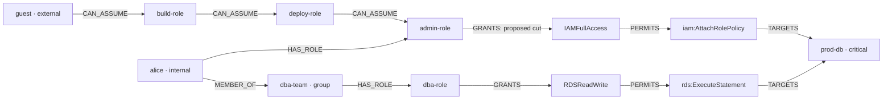
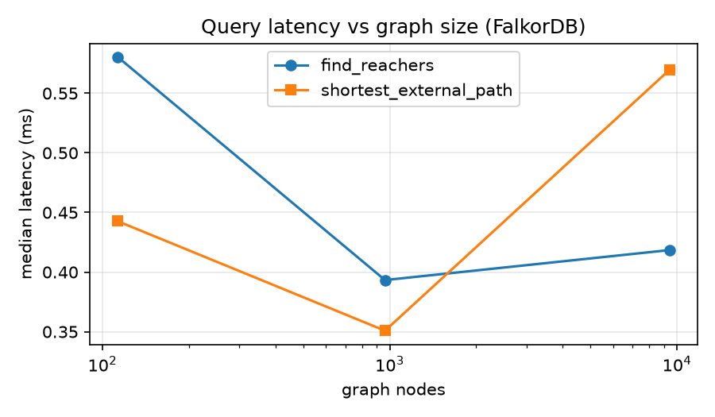

# Severance

**Given a cloud security finding, this agent traces shortest paths an untrusted identity could walk
to the exposed resource. It then picks the one load-bearing edge to cut, proves the fix on a copy
of the graph, and only then asks a human to approve it.**

The LLM plans and explains. Every path, count and score comes from a graph query.

Built for **Graph Hacks: Context for AI Agents**, powered by FalkorDB.
**Track 01: Agents That Act on Connected Data.** Team: **pied-piper**.

The project runs locally with seeded regression scenarios and a pinned public AWS IAM
snapshot from Cloudsplaining. FalkorDB is the operational context layer:
without it the agent cannot establish reachability, select a fix, simulate it, or apply it.

For a quick review: [local setup](#run-it), [graph model](#graph-data-model),
[essential queries](#queries-that-drive-the-agent), [public IAM results](#public-snapshot-benchmark),
and [Track 01 evidence](#track-01-evidence).

A scanner says *"prod-db is reachable."* This agent shows the 6-hop chain from a guest identity
and the one policy that chain depends on. Before approval, a graph-copy simulation checks
whether a proposed change closes the modeled exposure and preserves other callers'
access to the assessed target. Changes apply to FalkorDB only.

## Track 01 evidence

| Focus | Working implementation | Evidence |
|---|---|---|
| Multi-hop reasoning | Follow external identity → assumed roles → policy → action → resource; the escalation scenario spans 6 edges. | [Queries](src/severance/graph/queries.py), exact-path tests in [test_queries.py](tests/test_queries.py). |
| Graph queries and algorithms as tools | `GRAPH.RO_QUERY`, `algo.SPpaths`, and seeded `algo.betweenness` supply reachers, shortest paths, and broker rankings. | [Scoring](src/severance/scoring/blast_radius.py), [planner](src/severance/remediation/planner.py). |
| Tool selection through MCP | A live Claude Agent SDK session chooses from nine typed tools on the in-process `iam` MCP server. Built-in shell, filesystem, and web tools are disabled. | [MCP tools](src/severance/agent/tools.py), [agent loop](src/severance/agent/runner.py), live approve/reject tests in [test_end_to_end.py](tests/test_end_to_end.py). |
| Actions based on the graph | Score candidate cuts on copies, simulate the selected plan, ask for approval, then delete the specific approved edge. | [Dry-run](src/severance/remediation/dryrun.py), [approval gate](src/severance/remediation/apply.py), [safety tests](tests/test_remediation.py). |
| Explainable results | Show the exact exploit path, broker score, chosen edge, before/after metrics, alternatives, and an append-only audit trail. | [Audit implementation](src/severance/audit/log.py), [audit and safety tests](tests/test_remediation.py). |

`investigate` requests interactive approval before a mutation. Piped or non-interactive
input defaults to rejection. The graph-derived plan and dry-run stay in server-side
session state; the model refers to them by `plan_id` rather than supplying edited facts.

## Graph data model

| Label | Key properties | Meaning |
|---|---|---|
| `Principal` | `id`, `name`, `kind` | User, group, service, or untrusted external identity. Groups use the same label with `kind='group'`. |
| `Role` | `id`, `name`, `trust` | An assumable role in seeded scenarios; imported users/groups also use explicit permission-carrier adapters. |
| `Policy` | `id`, `name`, `managed` | A managed or inline permission policy. |
| `Action` | `id`, `name` | An action scoped to one resource, e.g. `iam:AttachRolePolicy@res-prod-db`. |
| `Resource` | `id`, `name`, `type`, `sensitivity` | Seeded cloud resource, or one concrete action/resource permission request in an import. |

| Relationship | Direction | Meaning |
|---|---|---|
| `MEMBER_OF` | Principal → group Principal | Identity inherits group membership. |
| `HAS_ROLE` | Principal → Role | Identity holds a role. |
| `CAN_ASSUME` | Principal or Role → Role | Identity or role can assume another role. |
| `GRANTS` | Role → Policy | Role carries a policy. |
| `PERMITS` | Policy → Action | Policy permits the action (`effect='allow'`). |
| `TARGETS` | Action → Resource | Action applies to this resource (`access='read'/'write'/'admin'`). |



The diagram shows the external escalation chain alongside an internal user's independent
database access. Removing the marked `GRANTS` edge closes external access while the
legitimate path remains connected; the dry-run verifies that outcome with graph queries.

IDs have label indexes; resources also have a name index. The seeded graph contains the
full IAM topology for each scenario and an unrelated decoy organisation. Ground truth
stays in the test/seeder layer and is never included in the agent's tools or finding prompt.
See [schema](src/severance/graph/schema.py) and [deterministic seeder](src/severance/graph/seeder.py).

## Queries that drive the agent

These are the essential Cypher operations, not a separate Python reconstruction of the
graph. Values such as `$rid` are passed as query parameters. Full queries and typed
decoding live in [graph/queries.py](src/severance/graph/queries.py).

**Who reaches the finding's resource?** Walk backward from the indexed resource to its
actions/policies/roles, then follow identity and assume-role relationships:

```cypher
MATCH (res:Resource {id: $rid})<-[:TARGETS]-(act:Action)
      <-[:PERMITS]-(:Policy)<-[:GRANTS]-(role:Role)
MATCH path = (p:Principal)-[:MEMBER_OF|HAS_ROLE|CAN_ASSUME*1..6]->(role)
RETURN p.id AS id, p.name AS name, p.kind AS kind,
       min(length(path)) + 3 AS hops,
       collect(DISTINCT act.name) AS via_actions
```

**Which shortest external paths explain that exposure?** `pathCount: 0` returns every
shortest path per external identity. Python sorts ties by path length and node IDs:

```cypher
MATCH (ext:Principal {kind: 'external'}), (res:Resource {id: $rid})
CALL algo.SPpaths({sourceNode: ext, targetNode: res,
                  relTypes: $rel_types, relDirection: 'outgoing', pathCount: 0})
YIELD path
RETURN [n IN nodes(path) | n.id] AS nodes,
       [r IN relationships(path) | type(r)] AS edges
```

**Which role or policy is load-bearing?** Sample betweenness with a fixed seed and
`$n = 10 × node count`, then retain role/policy endpoints on the external paths:

```cypher
CALL algo.betweenness({relationshipTypes: $rel_types,
                      samplingSize: $n, samplingSeed: 1337})
YIELD node, score
RETURN node.id AS id, score
```

`$rel_types` contains the six relationship types above. The planner uses `GRAPH.COPY`
to evaluate each candidate deletion and ranks the query-derived effects. After consent,
the mutation is a parameterized `MATCH ... WHERE type(rel) = $ty DELETE rel` for one
exact edge. Public-snapshot imports use the same graph algorithms and approval gate.
There is no AWS API call or AWS mutation.

## Public IAM snapshot

Severance also imports the [Cloudsplaining account-authorization example](https://github.com/salesforce/cloudsplaining/blob/f2ed0ba2ddf6457143203d46971c91ba236b6597/examples/files/example.json):
**44 users, 5 groups, 78 roles and 84 managed policies**, plus inline policies. The
unmodified input, pinned commit, checksum, upstream license and independently specified
case expectations are checked in under [datasets/cloudsplaining](datasets/cloudsplaining/README.md).
No AWS account or AWS credentials are needed.

Each import assesses one concrete permission request, such as `s3:PutObject` on an
example object in the source's `mybucket/*` resource pattern. The selected user or role
session is **assumed compromised**; this is not a claim of anonymous internet access.
The ARN remains the source ID. User/group policy attachments use a permission-carrier
`Role`, and a role-session `Principal` represents a session of a source role. These are
explicit graph adapters, not invented AWS roles or trust relationships. Reacher counts
include modeled group principals and hypothetical role sessions, not just individual
users or observed sessions. Resource sensitivity is an assessment default, not a source
snapshot property.

```mermaid
flowchart LR
    U["privesc-sre-user · assumed compromised"] -->|MEMBER_OF: proposed cut| G[privesc-sre-group]
    G -->|HAS_ROLE: schema adapter| C["group permissions · carrier"]
    C -->|GRANTS: source attachment| P[privesc-sre-admin-policy]
    P -->|PERMITS: source s3 wildcard| A["s3:PutObject"]
    A -->|TARGETS| R["permission request: mybucket/example.txt"]
```



The source attachment and group membership determine this five-edge explanation. FalkorDB
finds the path, ranks its brokers and evaluates candidate cuts. The agent receives the
finding and tool outputs; benchmark expectations are not passed to it.

Run an investigation on the public input from the repository root after setup:

```bash
.venv/bin/severance import-iam datasets/cloudsplaining/example.json \
  --action s3:PutObject \
  --resource-arn arn:aws:s3:::mybucket/example.txt \
  --untrusted-arn arn:aws:iam::012345678901:role/OverprivilegedEC2 \
  --graph iam_public_review --output results/iam_import
GRAPH_NAME=iam_public_review .venv/bin/severance investigate \
  --finding-file results/iam_import.finding.json
```

The destination graph must be empty; use a fresh name to repeat an import. Import validation
finishes before any graph writes. Review `results/iam_import.report.json` for coverage,
unknown identities and assumptions. Approval changes the imported FalkorDB graph only.

The importer supports unconditional identity-policy allows/denies, wildcard matching,
default managed-policy versions, inline policies and inherited group policies. Applicable
conditions, negations, policy variables, missing documents and permissions boundaries
produce **unknown**; an unknown selected identity aborts the import. Other unknown
identities are excluded from paths and listed in the report. Unknown is not a proven deny.
Role trust transitions, resource policies, SCPs/RCPs, session policies and actual resource
existence are outside this assessment. Collateral covers the single assessed permission
among supported callers. See [full import semantics](datasets/cloudsplaining/README.md#import-semantics-and-limits).

### Public-snapshot benchmark

Six cases cover role-attached S3 write access, group-inherited write and ACL access,
rejected approval, an explicit deny, and a deny in a separate attached policy.
Each positive case has a manually specified source-derived path/fix expectation.
Five engine repetitions per case measure exact paths, exact fixes and dry-run effects;
one real Sonnet 5.5 MCP-agent call per case checks the complete workflow.

**Measured on 2026-10-18: 30/30 engine evaluations and 6/6 full-agent investigations pass.**
Positive cases simulate 1 → 0 untrusted reachers with zero collateral among supported
principals. Approved runs delete exactly one graph edge; the rejection and deny controls
preserve the graph. All six final agent runs complete without tool errors.

| Case | Engine checks | Live agent | Path | Result |
|---|---|---|---|---|
| EC2 role: S3 write | 5/5 | 1/1 | 4 hops | Policy detached; assessed untrusted access closed |
| Inherited group: S3 write | 5/5 | 1/1 | 5 hops | Membership removed; assessed untrusted access closed |
| Inherited group: object ACL | 5/5 | 1/1 | 5 hops | Membership removed; assessed untrusted access closed |
| Rejected approval | 5/5 | 1/1 | 4 hops | Graph unchanged |
| Allow + deny in one policy | 5/5 | 1/1 | none | No remediation or mutation |
| Allow + deny across policies | 5/5 | 1/1 | none | No remediation or mutation |

[Full report](results/public_iam.md), [per-call checks, tool outputs and redacted audits](results/public_iam.json).
Earlier runs are retained: [initial lookups](results/public_iam_initial.json),
[quoted-name lookup](results/public_iam_lookup.json), and
[benchmark graph collision](results/public_iam_isolation.json). The first two reached all
expected task outcomes but each failed the stricter no-tool-errors check in one case.
The third was invalidated in one case by a concurrent benchmark deleting its shared
temporary graph. The final run follows fixes for exact resource-name handling and unique
per-invocation graph names; earlier errors are not discarded.
This small fixture check is not a production accuracy estimate or an LLM superiority claim.

```bash
# 30 engine evaluations and 6 paid full-agent investigations:
.venv/bin/severance benchmark-public --engine-runs 5 --agent-runs 1
# Same source-derived checks without paid calls:
.venv/bin/severance benchmark-public --engine-runs 5 --agent-runs 0
```

Each call is checkpointed to `results/public_iam.json`; API/tool errors are recorded and
the remaining cases continue. Every agent call imports a fresh isolated graph. The public
benchmark leaves the earlier seeded comparison artifacts intact.

## Seeded regression benchmarks

`make bench` writes everything below to `results/`.

**A. Correctness of the deterministic engine.** All four seeded scenarios pass on every column.

| scenario | found external path | chose root-cause fix | external reachers after | collateral |
|---|---|---|---|---|
| public_bucket | ✓ | ✓ | 0 | 0 |
| escalation_chain | ✓ | ✓ (deep pivot, not hop 1) | 0 | 0 |
| broker_policy | ✓ | ✓ | 0 | 0 |
| exposed_secret | ✓ | ✓ | 0 | 0 |

**B. Deterministic engine vs. tool-less Sonnet 5.5.** The baseline gets the raw node and edge
list in its prompt, plus the same objective and tie-break rule. This run used
`claude-sonnet-5-5` via the API on 2026-10-18, with 10 independent calls per scenario
(`--llm-runs 10 --baseline-scale 10`): 40 calls on graphs of 479–485 nodes and 540–547 edges.
Engine rows repeat the deterministic path query and planner, without LLM calls.

| scenario | condition | exact path | fix edge | same answer across runs | hallucinated edges | failed runs |
|---|---|---|---|---|---|---|
| public_bucket | engine | 100% | 100% | 100% | 0% | 0/10 |
| public_bucket | llm_no_tools | 100% | 100% | 100% | 0% | 0/10 |
| escalation_chain | engine | 100% | 100% | 100% | 0% | 0/10 |
| escalation_chain | llm_no_tools | 100% | **0%** | 100% | 0% | 0/10 |
| broker_policy | engine | 100% | 100% | 100% | 0% | 0/10 |
| broker_policy | llm_no_tools | 100% | **70%** | **70%** | 0% | 0/10 |
| exposed_secret | engine | 100% | 100% | 100% | 0% | 0/10 |
| exposed_secret | llm_no_tools | 100% | 100% | 100% | 0% | 0/10 |

Sonnet found every exact path and invented no edges. Its fix matched the planted edge in
27/40 calls (67.5%), compared with 40/40 for the engine. On the 6-hop `escalation_chain`,
all 10 calls cut `deploy-role -CAN_ASSUME-> admin-role` instead of detaching `IAMFullAccess`
from `admin-role`. On `broker_policy`, 7 calls detached the shared DB policy from the sandbox
role; 3 revoked the vendor's ability to assume that role. Fix accuracy measures the exact
expected edge under the planner's ranking. Both alternative cuts also close external access
to the target with zero internal collateral; the misses reflect the edge ranking.

The observed gap is in fix selection, including variation on `broker_policy`; this run does
not show path errors or hallucinated edges. [Full results](results/baseline_scale10.md),
[per-scenario metrics](results/baseline_scale10.json), and
[raw answers and checkpoint](results/baseline_scale10.runs.json) are saved. The earlier
[3-run small-graph comparison](results/baseline.md) remains available. Its artifacts do not
record the model, so these runs do not isolate graph size as a variable.

Reproduce the larger comparison with 10 calls per scenario (40 total), or use `--llm-runs 5`
for half as many calls:

```bash
.venv/bin/severance benchmark --llm-runs 10 --baseline-scale 10
# After an interruption, reuse saved calls with the same options:
.venv/bin/severance benchmark --llm-runs 10 --baseline-scale 10 --resume
```

Scale 10 writes `results/baseline_scale10.json` and `.md`, leaving the small-graph baseline
intact. Each completed call, including its raw answer or error, is saved atomically in
`results/baseline_scale10.runs.json`; summaries are updated after each scenario. `--resume`
fills missing calls and retains recorded failures. A fresh run without `--resume` starts a
new comparison. Failed calls and malformed answers count as accuracy and stability misses;
hallucinated-edge rates use valid answers only, with failures reported separately.

**C. Scale.** This is the median latency over 5 runs on `escalation_chain`, with the decoy org
scaled up.

| nodes | edges | find_reachers | shortest_external_path |
|---|---|---|---|
| 113 | 128 | 0.6 ms | 0.4 ms |
| 963 | 1,096 | 0.4 ms | 0.4 ms |
| 9,421 | 10,748 | 0.4 ms | 0.6 ms |



Both queries start from an indexed node and walk outward, so their cost follows the size of the
reachable neighbourhood, not the whole graph. The seeded decoys never connect to the target, so
this measures that best case.

## How it stays safe: the four invariants

1. **Determinism over vibes.** Reachability, paths and scores come from Cypher and plain Python.
   Tools return JSON that the model reads, and the model never computes a number itself.
2. **No silent mutation.** A fix is first measured on a server-side `GRAPH.COPY`. Applying it
   needs a single-use token that is minted only when the human approves, and the token is bound
   to a hash of that exact edge. Plans and dry-runs stay in server-side session state, keyed by
   `plan_id`, so the model can't hand back an edited plan or fake before/after numbers.
3. **Everything is auditable.** `audit/<run_id>.jsonl` gets a record for every tool call, plan,
   dry-run, approval and apply. Records for a plan or a mutation must carry the justifying path,
   or the log refuses to write them.
4. **Offline, scoped evidence.** Seeded fixtures provide exact regression truth. Public IAM
   imports preserve source policy attachments and group memberships for one permission
   request; unsupported cases are reported as unknown. There is no cloud SDK or AWS mutation.

The approval token is there to make applying without approval structurally impossible. It is not
meant to be cryptographically strong. Non-interactive runs reject by default.

## Severity formula

```
severity = w_sens · sensitivity_weight     (low=1, medium=2, high=3, critical=4)
         + w_ext  · min(external_reachers, CAP)
         + w_prox · max(0, MAX_HOPS − shortest_external_hops)   (0 if no external path)
```

The defaults are `w_sens=3, w_ext=2, w_prox=2, CAP=10, MAX_HOPS=8`, and all of them can be set in
`config.py` or `.env`.

## How the planner picks the edge

The candidates are the edges on at least one shortest external path. The planner cuts each one
on a graph copy and ranks them by these keys, in order:

1. fewest external reachers left
2. most shortest external paths closed
3. least collateral (internal principals that lose access)
4. highest broker score (betweenness of a Role or Policy endpoint on the path)
5. specificity: `CAN_ASSUME` into a broad-trust role, then `GRANTS`, `MEMBER_OF`,
   `HAS_ROLE`/`CAN_ASSUME`, `PERMITS`, `TARGETS`
6. edge id, as a stable final tie-break

Keys 4 and 5 make `escalation_chain` and `broker_policy` prefer the deep broker over hop 1.
Both may block the exposure, but the broker cut ranks higher under the declared policy.
If the runner-up ties on keys 1–3, the approval prompt shows it as an alternative.

## Architecture

```
cli/main.py ─ investigate · import-iam · benchmark-public · seed · benchmark · reset
     │
agent/runner.py ─ Claude Agent SDK loop, approver injected per run
agent/tools.py  ─ 9 typed tools → in-process MCP server ("iam"), per-call audit
     │
     ├── graph/       client (RO/RW, GRAPH.COPY context), schema, queries, seeder, IAM importer
     ├── scoring/     escalation paths, blast radius, severity
     ├── remediation/ planner · dryrun · token-gated apply
     └── audit/       append-only JSONL
     │
FalkorDB (Docker)
```

The agent calls the tools in this order: `get_finding_context` → `find_reachers` →
`shortest_escalation_path` → `rank_brokers` → `propose_remediation` → `simulate_remediation` →
`request_approval` → `apply_remediation` → `write_audit`.

## Run it

Requirements: Python 3.11+, [uv](https://docs.astral.sh/uv/getting-started/installation/),
Docker with Compose, and an Anthropic API key or authenticated Claude Code session for
the agent. Tests, graph inspection, and deterministic benchmarks work without an LLM key.
No hosted deployment is required; the complete application runs locally.

```bash
git clone https://github.com/mohi-devhub/Severance.git
cd Severance
uv sync --locked --all-extras --python 3.11
cp .env.example .env              # first setup only; preserve an existing .env
# Set ANTHROPIC_API_KEY and, if needed, MODEL in .env before agent commands.
make up                           # pinned FalkorDB, waits for a healthy database
make test                         # deterministic tests; no paid API calls
make lint
.venv/bin/severance investigate --scenario broker_policy  # real y/N in a terminal
make test-agent                   # opt-in paid approve/reject integration tests
make bench-engine                 # correctness + scale; no paid API calls
# make bench                      # defaults to 40 paid tool-less baseline calls
```

The agent authenticates through the Claude Agent SDK, using either `ANTHROPIC_API_KEY` or a
logged-in Claude Code. The API key can be exported in the shell or set in the ignored `.env`
file; a configured API key is passed to the SDK for both investigations and benchmarks.

The checked-in `uv.lock` reproduces dependencies. Docker Compose pins the verified
FalkorDB 4.22.1 image by its multi-platform digest and binds port 6380 to localhost.
The graph is disposable in this local setup; use `seed` to recreate any scenario.
If 6380 is occupied, choose a free `FALKOR_PORT` in `.env`. `make up` and the client
read the same setting. `investigate --scenario` replaces its active synthetic graph,
while tests and benchmarks use separate graph names.

For a judge without API credentials, `make test` verifies the graph queries, planner,
dry-run and approval gates. `make test-agent` exercises the real MCP agent loop.
GitHub Actions runs lint, formatting, the deterministic suite against FalkorDB, and a
wheel/source build on every push; no LLM secret is needed for CI.

## Scope and AI assistance

This submission enters **Track 01 only**. It demonstrates decisions and actions over
connected IAM data; it does not implement cross-session conversational memory,
multi-agent coordination, or a company knowledge graph.

Four seeded scenarios provide regression ground truth. A separate benchmark imports a
pinned, publicly maintained Cloudsplaining example snapshot. This is external fixture
data, not a verified production-account export. Exact-edge benchmark accuracy checks
the declared ranking policy, and the query scale test uses disconnected decoys; neither
is a claim of production cloud coverage. Shortest paths are the
explanations shown, rather than an enumeration of every possible exploit path.

**AI coding disclosure:** Codex was used for development.

All reported benchmark numbers come from recorded runs. Deterministic tests and live
approve/reject agent tests verify the implementation. The model selects tools and
explains their outputs; it is not the source of graph facts or scores.

The [source repository](https://github.com/mohi-devhub/Severance) is public and can be
reviewed without signing in. See [submission notes](SUBMISSION.md) for the Track 01
requirements and verification status.

## Implementation notes

- **Action nodes are scoped per resource** (`id = "s3:PutObject@res-prod-artifacts"`). With one
  global node per action string, any policy that permits `s3:GetObject` would appear to reach
  every bucket.
- **Paths come from `algo.SPpaths` with `pathCount: 0`, run per external principal.** On this
  FalkorDB build (v4.22), `shortestPath()` is only allowed in `WITH`/`RETURN`. SPpaths gives every
  shortest path in one call, and ties are broken by node ids.
- **Betweenness is seeded and sampled at 10× the node count.** `algo.betweenness` samples source
  nodes with replacement. A 1× sample sometimes missed the only external source entirely.
- **The var-length hop bound is inlined** as a range-checked int (2–8). FalkorDB can't take it as
  a parameter.
- **Tools take a `plan_id`, not a plan payload** (see invariant 2).
